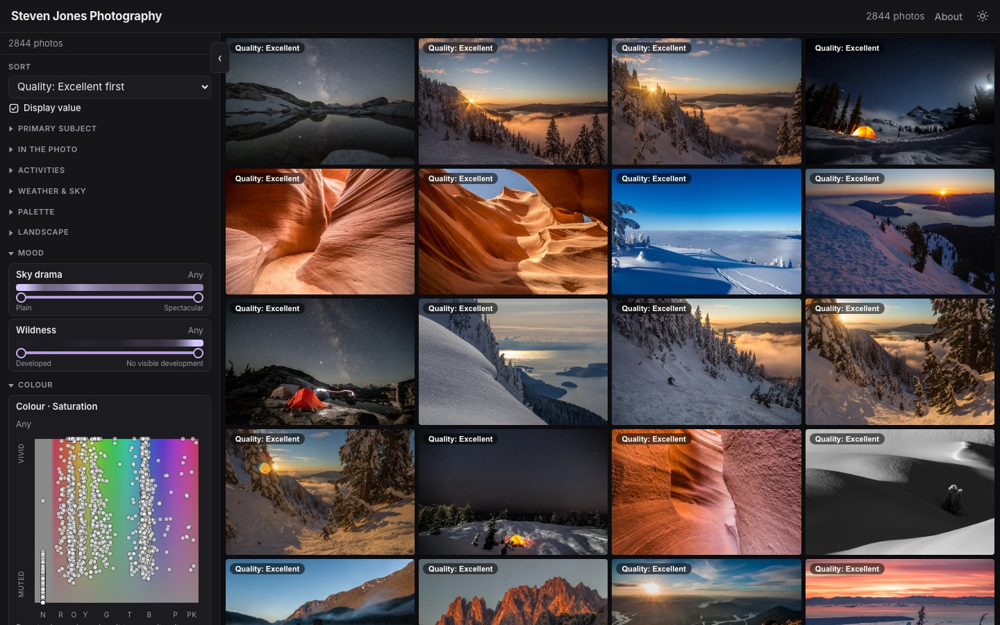

# Photo Ferret

**Ferret out the photo you want.** An AI image model looks at every photo and rates it on dozens of scales: how much sky, water or snow it shows, how dramatic the sky is, how wild the scene feels, how warm or vivid its colours are, whether it's a close-up or a vista, and its overall quality. Visitors then browse a large collection with sliders over those scales, a colour picker and yes/no tags, instead of scrolling through it.

**Live demo:** [stevenjonesphotography.ca](https://stevenjonesphotography.ca), about 2,800 nature photos from 2009–2026.

[](https://stevenjonesphotography.ca)

It comes in two parts: a **local authoring tool** on the owner's computer, where photos are uploaded and [TypeSafe](https://typesafe.ai)'s **Jev** image model tags each one automatically, and a **static site** exported from it and hosted on Cloudflare. Visitors browse the photos as large thumbnails and filter them by tag; all filtering runs in the browser.

- **Public gallery** (`/`): filters in a left sidebar and the photo grid on the right. Each side scrolls on its own. On desktop the sidebar collapses with its tab; on phones it opens as a drawer from the **Filters** button. The filter panel has:
  - **Primary subject**; yes/no tags for **people**, **wildlife** (not birds) and **birds** (Any / With / Without); and chips for **activities** (hiking, skiing, paddling, climbing, cycling, camping), **weather & sky** (weather, sunrise/sunset, night sky, rainbow) and the **colour palette** (pick several colours; **Primary colour only** matches just each photo's main colour).
  - **Sliders:** a two-handle range per category, for example "sky ≥ 50% of the frame", with a density strip above it (brighter where more matching photos fall). Mood sliders: sky drama, wildness. Colour sliders: colour diversity, warmth, brightness (saturation is set with the colour picker). Look & composition sliders: **quality** (1–100, as a nature photography club judge would rate it, Unusable … Excellent), tonal contrast, scene complexity, straight lines, curvy lines, scale (macro → vista) and depth of field. Once a slider is narrowed, drag the shaded window between its handles, or focus it and use the arrow keys, to move the whole range. A **colour picker** (colour across, saturation up) lets you drag out a box to filter on both, placing photos by their main colour.
  - **EXPERIMENTAL - 3D MAP** (the last section, collapsed until opened): one 3D cube with water → foothills → mountains across (sky is left out), main colour up and scale (macro → vista) in depth. Rotate it by dragging; place a pointer and widen it into a sphere to show the photos inside. Each photo is a dot; hover a dot to see it. It works like any other filter: off until you place the pointer, combined with the other filters, and cleared by × or Clear filters.
  - **Gallery options** in the admin panel sets the **site name** (the page title and header) and the **About text** (a note at the top of the **About** page, which also explains in plain language how the photos were tagged).

  The default sort is **Random** (a new shuffle each visit, with no text over the photos); you can also sort **Newest first**, by the date taken from each photo's EXIF (photos without one follow, newest upload first), by **Image number**, or by any slider dimension. **Copy link** in a photo's details copies a link that opens that photo. Photos are named **Image 1, Image 2…** in upload order; the uploaded file name is shown only in the admin. On upload, potentially sensitive metadata is removed before the photo is stored: GPS location, camera and lens serial numbers, names and contact details, maker notes, embedded preview thumbnails, XMP and IPTC. Only the colour profile, orientation and date taken are kept, and JPEGs keep their exact image data. Filters are kept in the URL, so a filtered view can be shared. Clicking a photo opens a lightbox showing its tags, approximate coverage, mood, colour and look (there's no download; originals stay on the owner's computer). **Gallery view** (the button on the photo, or click the photo) shows just the photos on black, stepping through the filtered set with the arrows, arrow keys or a swipe. **Slideshow** (next to Gallery view, with a seconds box from 3 to 60) plays the filtered photos full screen on a timer and loops, with an optional crossfade (**Fade**); pause with the button or the space bar, and Esc or × ends it.
- **Admin** (`/admin/`): sign in to upload several photos at once.
  - Jev tags each photo in the background.
  - You can override any tag. Overrides survive re-running Jev.
  - You can also set a title and description, hide a photo from the public site, re-run Jev, or delete a photo.

## Run

```sh
cp .env.example .env          # set TYPESAFE_API_KEY, ADMIN_USER, ADMIN_PASSWORD, SESSION_SECRET
npm install
npm run dev                   # site on http://localhost:5173 (admin at /admin/), API on :3001
```

Needs Node 24 or later, for the built-in `node:sqlite`.

| Script | What it does |
|---|---|
| `npm run export-site` | Writes the static site to `site/` (see below; no Jev calls) |
| `npm run preview-site` | Serves `site/` locally the way Cloudflare will (also at `/preview/` in the admin) |
| `npm run deploy` | Uploads `site/` to Cloudflare (`wrangler deploy`; only changed files) |
| `npm run build && npm start` | The local tool built: the server serves `dist/` and the API on `:3001` |
| `npm run import-folder -- <folder>` | Uploads every image in a folder through the admin, in name order (which sets the image numbers); skips files already imported. Needs `npm run dev` running; each new photo costs Jev requests. `--limit N` for a trial run |
| `npm run rebuild-derived` | Rebuilds all thumbnails and display images from the stored originals (no Jev calls) |
| `npm run score-quality` | Scores the quality of photos that have no score (one Jev request each); `-- --force` rescores all, needed after changing the quality question |
| `npm run remap-quality` | Recomputes every quality value from its stored Jev reading after a change to the curve in `server/jev.ts` (no Jev calls) |
| `npm run remeasure` | Recomputes the pixel-measured tags (warmth, saturation, brightness, palette) for every photo (no Jev calls) |
| `npm run probe -- photo.jpg` | Sends one photo to Jev and prints the raw and normalized answers (one live request) |
| `npm run typecheck` | TypeScript check |

### The static site

`npm run export-site` writes `site/` (gitignored, set another folder with `SITE_DIR`):

```
index.html, assets/            the gallery page alone (no admin)
data.json                      settings, public tag definitions, and every published photo's effective tags
img/<n>/thumb.<hash>.webp      by image number and a hash of the contents, cached for a year
img/<n>/display.<hash>.webp
_headers                       Cloudflare cache rules
```

- **No private data.** `data.json` has no internal ids, original file names, Jev confidences or raw answers, and no unpublished photos. Never the Jev JPEG or the originals.
- **Incremental.** Re-exporting copies only new or changed images and removes those of unpublished or deleted photos.
- **Deploy.** `wrangler.jsonc` deploys `site/` as Cloudflare Workers static assets. The free plan allows 20,000 files of up to 25 MiB each, about 10,000 photos. Sign in once with `npx wrangler login`. **For your own copy, change the worker `name` and the `routes`** (they're the author's domain), or remove `routes` to use a `workers.dev` address. A custom domain needs its DNS on Cloudflare. To host the images elsewhere (such as R2), set `SITE_IMAGE_BASE` to their address: they're written to `site-images/` instead.
- **Dev.** In `npm run dev` the local server serves `/data.json` and `/img/…` live from the database, so the gallery works the same as the exported site.

## Storage

Everything lives in `DATA_DIR` (default `./data`, gitignored):

```
photos.db                      SQLite: photos + per-photo tags
originals/<id>.<ext>           the uploaded photo, sensitive metadata removed (see below)
derived/<id>/thumb.webp        800 px long side, for the gallery grid
derived/<id>/display.webp      2048 px long side, for the lightbox
derived/<id>/jev.jpg           the exact JPEG sent to Jev (the boxes line up with it)
```

- **Originals:** kept exactly as uploaded, at full resolution, up to 100 MB each. A duplicate upload (same SHA-256 hash) is rejected.
- **Derived images:** rotated upright, stripped of all metadata, and rebuilt automatically if one is missing.
- **Files that can't be decoded** (such as HEIC or camera RAW): the original is still stored and downloadable, and the photo is marked with an error in the admin.

To back up the site, copy the `data/` folder.

## How it works

```
admin upload ─▶ originals/ ─▶ queue (2 at a time): derived images ─▶ Jev (systemOne, one request per photo) ─▶ photo_attributes
npm run export-site ─▶ site/: data.json (effective tags: override ?? Jev) + images ─▶ wrangler deploy ─▶ Cloudflare
gallery: loads data.json once, then filters, counts, sorts and places the map in the browser (shared/gallery.ts)
```

- `server/questions.ts`: the questions sent to Jev, and the `ATTRIBUTES` list derived from them.
  - Coverage is one Score question per category, with six described levels mapped to a share of the frame. Categories are judged independently, so they can add up to more than 100%. Snow deliberately overlaps whatever it covers.
  - "Contains" means P(any amount) = 1 − P(None) > 0.5, kept separate from the expected share used by the sliders.
  - People, wildlife, birds and the other yes/no tags are Nouls, stored as yes (P ≥ 0.7), no (P ≤ 0.3) or unsure. Unsure People/Wildlife/Birds answers get a second look at sharper tiles of the original.
  - Mood and look are Score scales. Warmth, saturation, brightness and palette are measured from the pixels.
  - Panoramas too elongated for Jev's size limits (over 5.6 : 1) are tagged as overlapping tiles and the answers combined.
  - The experiment that chose this approach is written up in `docs/jev-image-capabilities.md`. This list is the single source of truth for tags. The database rows, the admin edit controls and the public filters are all generated from it, so a new kind of metadata means a new question plus an `ATTRIBUTES` entry, with no schema change.
- `server/db.ts`: SQLite schema and migrations.
  - Each tag is stored with Jev's value, Jev's confidence, and an optional admin override.
  - The effective value is the override if set, otherwise Jev's value.
- `server/storage.ts`: originals and derived images.
- `server/imagePrep.ts`: Jev rejects images outside its limits instead of resizing them, so every image is normalized first:
  - EXIF rotation is applied to the pixels.
  - Each side is fitted between 280 and 1568 px. Small images are upscaled, never padded.
  - The result is re-encoded as a baseline JPEG.
- `server/classifyQueue.ts`: background tagging. Photos still pending when the server restarts are queued again.
- `server/auth.ts`: the single admin account from `.env`, with a 7-day HMAC-signed session cookie.
- `server/jev.ts`: the TypeSafe client. It sends the `TypeSafe-Danger-Zone-Images: true` header, normalizes answers, and maps API errors to friendly messages.
- `server/siteData.ts` and `scripts/export-site.ts`: the static site's `data.json` and its export.
- `shared/gallery.ts`: the gallery's filtering, facet counts, histograms, sorting, colour picker and 3D map, run in the browser.
- `web/`: Vite + vanilla TypeScript. `index.html` is the gallery and `admin/index.html` is the admin side.

The local server's `/media/…` images are for the signed-in admin only.

> Images and Box are TypeSafe **preview** ("dreamer-ready") features: formats, limits, and accuracy may change.

See [`docs/jev-image-capabilities.md`](docs/jev-image-capabilities.md) for a synopsis of the image models and lessons from building the original classifier.

## Disclaimer

- **Unofficial.** This is an independent demo project. It is not affiliated with, endorsed by, or supported by TypeSafe. "TypeSafe" and "Jev" are TypeSafe's names.
- **Preview features.** It uses TypeSafe's image and Box features, which TypeSafe labels as preview ("dreamer-ready") and not for production. They may change or stop working without notice.
- **Your photos go to a third party.** Every uploaded photo is sent to TypeSafe's API for analysis. Don't upload images you aren't comfortable sharing, and read TypeSafe's terms and privacy policy.
- **Results can be wrong.** Classifications are model guesses. Don't rely on them for anything important, such as safety, identifying people, or legal decisions.
- **Your key, your bill.** You supply your own API key and are responsible for its usage and costs. The authoring tool is meant to run only on your own computer; don't put it on the internet.
- **What's published.** The static site holds every published photo's thumbnail and display image (metadata stripped) and its tags. Originals are never exported.
- **No warranty.** The software is provided "as is", without warranty of any kind. See [LICENSE](LICENSE).

## License

The code is [MIT](LICENSE)-licensed. The photos on [stevenjonesphotography.ca](https://stevenjonesphotography.ca), including those in `docs/screenshot.jpg`, are © Steve Jones, all rights reserved, and aren't covered by the MIT licence. The gallery shows a copyright line at the bottom of the filters, made from the site name.
